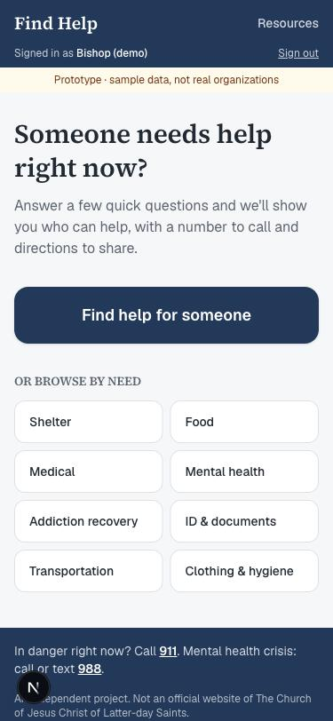
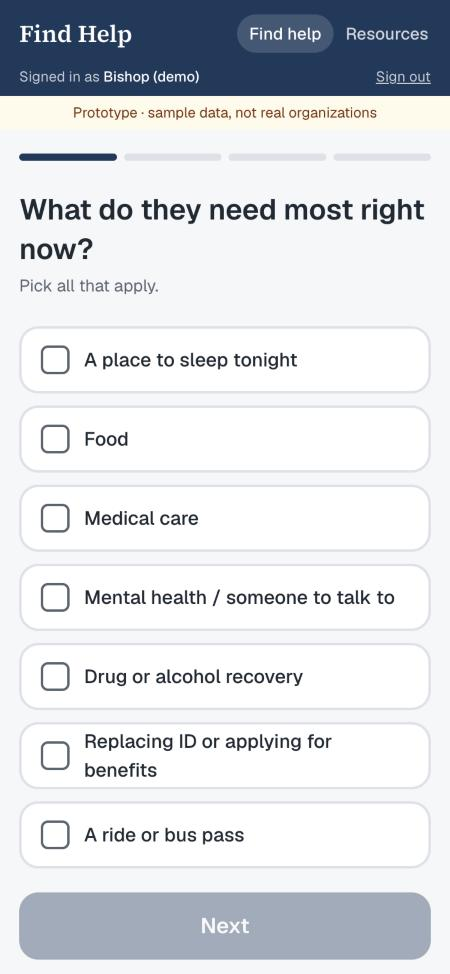
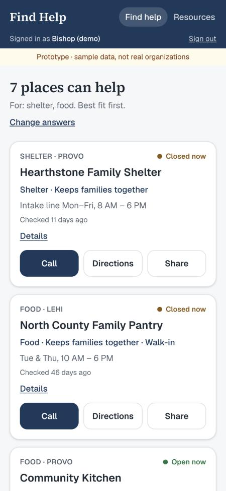
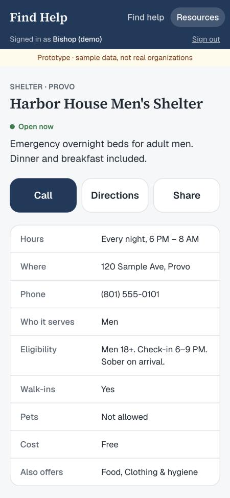
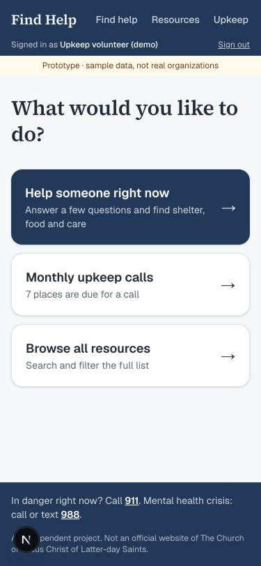
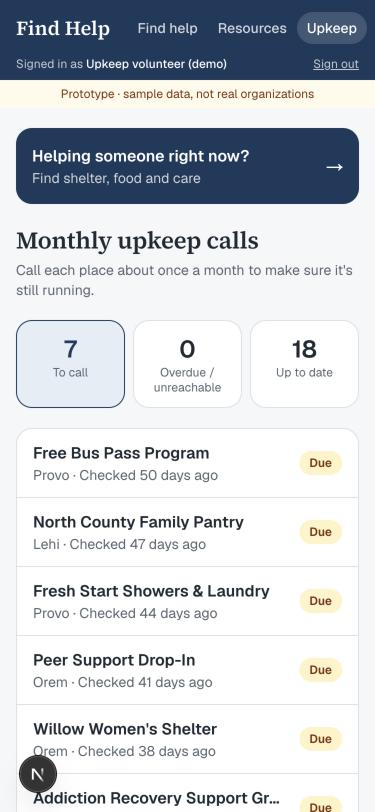

# Prototype screens and flows: 2026-10-12

Screenshots of the live prototype (https://find-help-provo.vercel.app) at phone width, with
sample data. No one outside the team has used it yet, so there are no usability tests this
week. The first ones come with the DI worker pilot.

## Flow 1: a leader helps someone right now (officials and upkeep volunteers)

Sign in → home → "Find help for someone" → 4 quick questions → ranked matches → call,
directions or share.

| Home | Questions | Matches | Place detail |
|---|---|---|---|
|  |  |  |  |

Design choices:

- **Phone first, one hand.** Leaders are likely in a hallway or office with the person in
  front of them. Big tap targets, one question per screen.
- **Nothing identifying is asked.** Answers live in the URL only; no names are stored.
- **Each match says why.** e.g. "Shelter · Keeps families together", so the leader can trust
  the order without reading every listing.
- **Handoff is three buttons:** call, directions, share. Share sends a plain text with name,
  phone, address and hours.

## Flow 2: an upkeep volunteer keeps listings current

Sign in → "What would you like to do?" → monthly upkeep calls → pick a place → call → record
the outcome (still running / closed / couldn't reach), fix details, add a note.

| Upkeep home | Call list |
|---|---|
|  |  |

Design choices:

- **Volunteers do two jobs**, so they choose instead of landing in either one.
- **Most urgent first:** couldn't reach, then overdue (60+ days), then due (30+ days).
- **Closed places disappear for leaders; unreachable ones show "call ahead".** A stale
  listing is worse than none when someone needs a bed tonight.

## Questions to answer in usability tests

1. Can a DI worker get from sign-in to a phone number in under a minute, without help?
2. Are the 4 intake questions the ones they'd actually ask? What's missing?
3. Do they trust the match order, or scroll through everything?
4. Do they use Share, and would the person they're helping have a phone to receive it?
